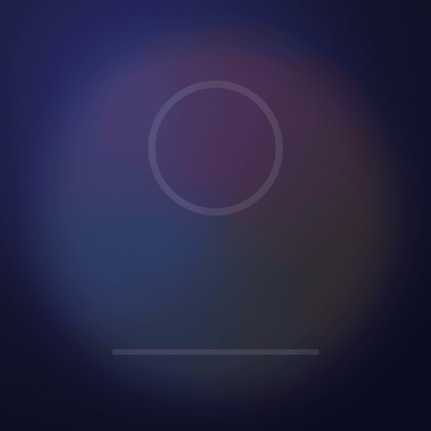

# html2mp4

Render any HTML animation to MP4, frame by frame, the same way every time. CSS keyframes, transitions, Web Animations, GSAP, Canvas, Three.js, SVG: **no changes to the page**.

Built for pages that AI coding agents write: they are good at HTML, CSS and GSAP, and this turns that page into a video with one command. Comes with a [SKILL.md](SKILL.md) for Claude Code and an [llms.txt](llms.txt).

<p>
  
  
</p>

Both GIFs above were rendered by html2mp4 from [examples/](examples/) (`-o demo.gif`).

## 30-second quickstart

You need Node 22.12+, Chrome or Chromium, and ffmpeg. `npx html2mp4 doctor` tells you what it found.

No Chrome (a server, CI, Docker)? `npx @puppeteer/browsers install chrome-headless-shell@stable --path ~/.cache/puppeteer` downloads one where html2mp4 finds it (without `--path` it goes into the current folder, which is also searched). On a bare Linux image, add `--install-deps` and run it as root to get the shared libraries Chrome needs. Where Chrome's sandbox can't run (Docker as non-root, Ubuntu 23.10+ AppArmor), html2mp4 starts it with `--no-sandbox` and says so.

```bash
npx html2mp4 render page.html -o out.mp4
```

Vertical short video with a voiceover, then check it before you post it:

```bash
npx html2mp4 render reel/ -o reel.mp4 --preset vertical --duration 12 --audio voice.mp3
npx html2mp4 check reel.mp4 --sheet sheet.png
```

Look at a few frames without rendering the whole thing:

```bash
npx html2mp4 snap page.html --at 0,1.5,3,6 --sheet sheet.png
```

## How it works

html2mp4 loads the page in headless Chrome with a small runtime injected before any page script. That runtime replaces the page's clocks with a virtual one that only moves when the renderer says so:

| What the page uses | What happens |
|---|---|
| `requestAnimationFrame`, `performance.now()`, `Date`, `setTimeout`, `setInterval`, `requestIdleCallback` | Run on virtual time, one frame at a time. Timers fire at their exact virtual due time, in order. |
| CSS animations and transitions, `element.animate()` | Held and set to the exact virtual time every frame. `animation-play-state`, `play()`/`pause()`, `finished` promises and `animationend`/`transitionend` events still behave. |
| GSAP, Three.js (`THREE.Clock`, `setAnimationLoop`), anime.js, hand-written rAF loops | Work as-is, because they read the clocks above. |
| SVG SMIL (`<animate>`) | Paused and seeked every frame. |
| `Math.random()` | Seeded (`--seed`, default 1), so particles land in the same place every render. |

Each frame is captured as a PNG and piped straight into a single ffmpeg process (no temp folder): H.264, yuv420p, BT.709, `+faststart`. `-o x.webm` gives VP9, `-o x.gif` gives a palette-optimized GIF.

The page is served from a local HTTP server on 127.0.0.1, so ES modules, `fetch()` of local files and relative assets work. Fonts and images are loaded before frame 0.

### Optional: tell it the size and length

Nothing is required. Without hints the video is 1920x1080, 30 fps, and as long as the page's finite CSS/GSAP animations plus a 0.5 s hold. Any of these override that (command-line options override the page):

```html
<meta name="html2mp4" content="size=1080x1920; duration=12; fps=30">
```

```js
window.__render = { width: 1080, height: 1920, duration: 12, fps: 30 };
```

### Optional: drive time yourself

If the page already draws "the frame at time t" on demand, expose it and html2mp4 calls it instead (timers and rAF are frozen; one rAF tick runs after each seek):

```js
window.__render = { duration: 12, seek: async (t) => drawFrame(t) }; // t in seconds
// or simply: window.__render = (t) => drawFrame(t);
```

Seek pages are random-access, so they render on several pages in parallel (`--workers`). Pages on virtual time render in order on one page, because their state depends on every earlier frame.

## Commands

```
html2mp4 render <page.html | folder | url> [-o out.mp4] [options]
html2mp4 snap   <page.html | folder | url> --at 0,1.5,3 [-o frames/] [--sheet sheet.png]
html2mp4 check  <video.mp4> [--sheet sheet.png] [--transcode]
html2mp4 doctor
```

Main `render` options (`html2mp4 --help` has all of them):

| Option | Default | |
|---|---|---|
| `-o, --output` | `<page>.mp4` | `.mp4`, `.webm` or `.gif` |
| `-s, --size` / `-p, --preset` | page, else `1920x1080` | presets: `vertical` 1080x1920, `landscape` 1920x1080, `square`, `portrait` 1080x1350, `720p`, `4k` |
| `-d, --duration` | page, else inferred | seconds |
| `-f, --fps` | page, else 30 | |
| `-a, --audio` | | muxed as AAC 48 kHz, padded or cut to the video length |
| `--dpr` | 1 | page viewport = size / dpr (`--size 540x540 --dpr 0.5` renders a 1080 px layout at half size) |
| `--wait-for` | | JS expression; frame 0 is the first frame where it is true |
| `--check-determinism` | | render again in a fresh browser and compare every frame |
| `--qc` | | run `check` on the result |
| `--json` | | machine-readable summary on stdout; logs stay on stderr |

Exit codes: 0 ok, 1 error, 2 bad usage, 3 a determinism or QC check failed.

## Determinism

`--check-determinism` renders the page a second time in a new browser process (seek pages: also a different split across pages, in reverse order) and compares every frame by SHA-256. When a frame differs it decodes both and reports how much:

- **bit-identical**: every frame hashes the same. This is the usual result for the examples, and two separate renders of the Canvas example give byte-identical MP4 files (`npm test` checks this).
- **visually identical**: at most 0.05% of a frame's pixels differ by more than 2/255 and nothing by more than 64/255. Chrome rasterizes an element whose transform or opacity is changing slightly differently depending on timing inside its compositor, which shows up as antialiasing on that element's edges. Measured here: the CSS example, run 4 at a time under load, occasionally had one frame where 128 edge pixels of a scaling circle differed by up to 25/255; a 30 s production page (subtitles faded from JavaScript, rendered on 6 pages, re-rendered in reverse order) had 486 of 912 frames bit-identical and the rest off by at most 6/255 on 2 pixels.
- **fail**: anything more. That is a real bug: randomness that is not `Math.random`, state that depends on seek order, an image that resamples differently, content that loads late. `npm test` includes a page with unseeded randomness to make sure this fails.

What html2mp4 does to get there: virtual clocks, seeded `Math.random`, a fixed `new Date()` (2026-01-01T00:00:00Z at t=0), CPU rasterization of page content (`--disable-gpu-rasterization`; WebGL still uses the GPU), GSAP's `force3D` turned off (its `translate3d` layers were the source of run-to-run pixel noise; 2D transforms look the same), one rendering step per frame, every frame of a virtual-time page drawn through the same capture path, and CSS animations held at their end instead of being finished (finishing hands them from the compositor back to the main thread, which raced with the next screenshot).

To see what differs, set `HTML2MP4_DUMP_DIR=some/folder`: both versions of every differing frame are saved there.

WebGL output can differ between machines (different GPUs). `--gl swiftshader` uses software WebGL, slower, which takes the GPU out of it: renders on the same OS repeat bit for bit, and macOS and Linux land within 1/255 of each other (measured on the Three.js example, Chrome 155 on arm64 for both: about 1% of pixels off by 1). Linux machines without a GPU (CI, Docker) use SwiftShader anyway.

## Quality checks

`html2mp4 check video.mp4` (or `render --qc`) gates the finished file on things that go wrong when short videos get posted:

| Gate | Fails when |
|---|---|
| format | not H.264/VP9/AV1, not yuv420p, odd size, or `moov` atom at the end (no faststart) |
| first frame | frame 0 is a flat color: thumbnails and the first impression are empty |
| frozen | the longest stretch where under 0.05% of pixels change exceeds `--max-freeze` (default 2 s) |
| loudness | true peak above -1 dBTP; warns when integrated loudness is more than 2 LU from `--lufs` (default -14) |
| transcode (`--transcode`) | warns when, after a 2 Mbps x264 re-encode like a platform does, mean SSIM < 0.97 or any frame in the first 3 s < 0.90 |

`--sheet sheet.png` writes 8 evenly spaced frames as one image, which is the cheapest way for an agent (or you) to look at a render.

## For AI agents

- Claude Code: copy [SKILL.md](SKILL.md) to `~/.claude/skills/html2mp4/SKILL.md`. It covers how to write a page that renders well and the render, look, fix loop.
- Other agents: point them at [llms.txt](llms.txt).
- Use `--json` for a parseable summary, `snap --sheet` to look at frames, and `check` before handing a video back.

## Limits

- `<video>` and `<audio>` elements inside the page play in real time; they are not synced to virtual time. Mux audio with `--audio` instead.
- Iframes, Web Workers and `OffscreenCanvas` drawn in a worker are not virtualized.
- A page that busy-waits on `performance.now()` (`while (performance.now() < t) {}`) hangs, because time does not move inside a frame.
- Speed: a virtual-time page renders at roughly 12-15 frames/s at 1080x1920 on an M-series Mac (each frame is a screenshot); seek pages scale with `--workers` (a 30 s 1080x1920 page rendered in 22 s on 6 pages).
- Elements promoted to compositor layers and animated from JavaScript by libraries other than GSAP (e.g. `translate3d` set by hand) can show the 1-6/255 noise described above.
- Fonts come from the machine unless the page ships them. The examples ask for Avenir Next, which only macOS has; on Linux they fall back to Liberation Sans (Arial-compatible), so they look plainer than the GIFs above. For the same typeface everywhere, load a font file with `@font-face` (each OS still rasterizes text slightly differently).

## Prior art

Remotion, HyperFrames, timecut, pagereel and others: see [PRIOR-ART.md](PRIOR-ART.md) for what each does and how this one differs.

## Development

```bash
npm install
npm test   # renders every example, checks QC and determinism (about 3 minutes)
```

CI ([.github/workflows/test.yml](.github/workflows/test.yml)) runs `npm test` on ubuntu-latest with chrome-headless-shell and keeps the contact sheets as a build artifact. The same suite in Docker, from a Mac or anywhere:

```bash
docker run --rm -v "$PWD":/src:ro node:22 bash -c 'cp -r /src /w && cd /w && rm -rf node_modules chrome-headless-shell && apt-get update -qq && apt-get install -yqq ffmpeg >/dev/null && npx -y @puppeteer/browsers install chrome-headless-shell@stable --install-deps && npm ci && npm test'
```

MIT licensed.
